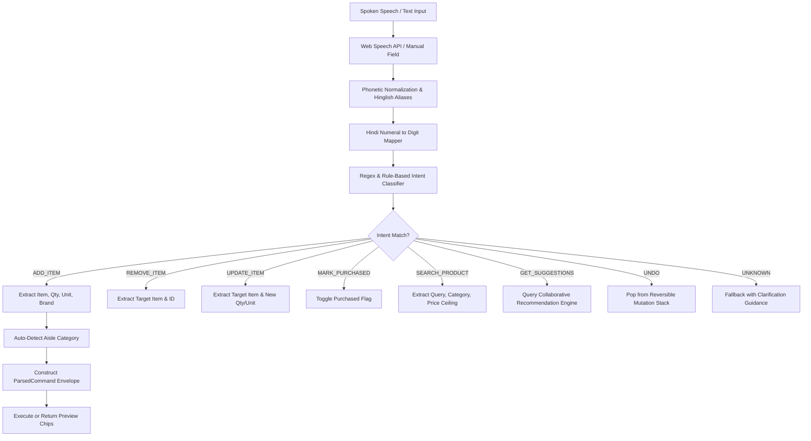
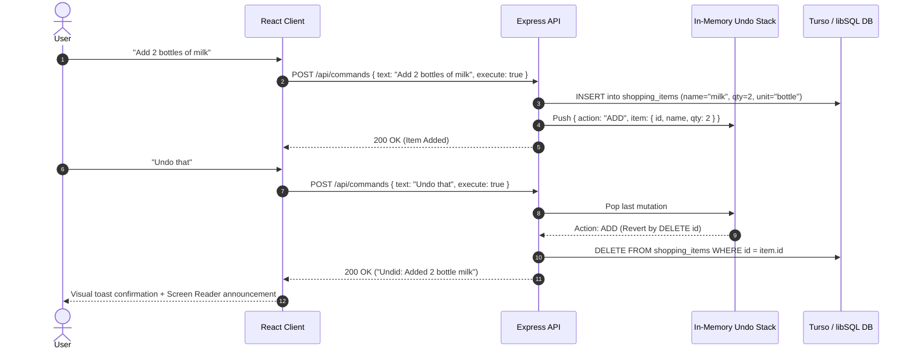

# 🎙️ Voice Command Shopping Assistant

[](https://www.typescriptlang.org/)
[](https://react.dev/)
[](https://expressjs.com/)
[](https://orm.drizzle.team/)
[](https://turso.tech/)
[](https://tailwindcss.com/)
[](https://vitest.dev/)
[](https://opensource.org/licenses/MIT)

A modern, voice-first shopping assistant web application engineered with natural language understanding (NLU), **Hinglish** (Hindi-English code-switching) bilingual parsing, real-time Web Audio frequency waveform visualization, smart product recommendations, in-place interactive spotlight onboarding, and offline-resilient PWA synchronization.

> **⚠️ Demo Data Notice:** The product catalog (35+ items across 8 aisles) and purchase history (9 records) are **seeded demo data** provided to demonstrate catalog search, category classification, and collaborative suggestion algorithms. All seeded records are explicitly labeled.

---

## 📑 Table of Contents

- [Key Engineering Highlights](#-key-engineering-highlights)
- [Architecture & System Design](#-architecture--system-design)
  - [High-Level System Topology](#high-level-system-topology)
  - [Command Processing & NLU Pipeline](#command-processing--nlu-pipeline)
  - [Reversible Mutation Stack ("Undo That")](#reversible-mutation-stack-undo-that)
- [Domain Contracts & Shared Types](#-domain-contracts--shared-types)
- [Hinglish Bilingual NLU Layer](#-hinglish-bilingual-nlu-layer)
- [Uniqueness & Key Differentiators](#-uniqueness--key-differentiators)
- [Tech Stack & Decision Rationale](#-tech-stack--decision-rationale)
- [REST API Specification](#-rest-api-specification)
- [Automated Testing Suite](#-automated-testing-suite)
- [Local Development Setup](#-local-development-setup)
- [Production Deployment Blueprint](#-production-deployment-blueprint)
- [Security Review & Threat Model](#-security-review--threat-model)
- [Project Structure](#-project-structure)

---

## ⚡ Key Engineering Highlights

- **Zero Paid Dependencies:** Uses browser-native Web Speech API (`SpeechRecognition` & `SpeechSynthesis`) and Web Audio API (`AnalyserNode`) — **no external paid API keys required**.
- **Shared Domain Types:** Monorepo architecture with `@voice-shopping/shared` containing canonical contracts for `ParsedCommand`, `CategoryMap`, `ApiSuccess<T>`, and `ApiError`.
- **Edge SQLite Persistence:** Drizzle ORM + Turso (libSQL over HTTP). Operates identically in local development (`file:local.db`) and serverless edge deployment with zero ephemeral disk concerns.
- **Strict TypeScript & Zod:** 100% strict type safety across client, server, and shared packages with runtime schema validation on every single mutation.
- **75 Automated Vitest Tests:** 39 backend integration & unit tests + 36 frontend component & hook tests covering all edge cases, entity parsing, duplicate merging, and undo operations.
- **Optimistic UI & Offline Queue:** UI reflects actions in under 300ms, while background queues persist and replay mutations automatically when connectivity resumes.

---

## 📐 Architecture & System Design

### High-Level System Topology

```
┌─────────────────────────────────────────────────────────────────────────────┐
│                              REACT 18 CLIENT                                │
│                                                                             │
│  ┌──────────────────┐   ┌───────────────────┐   ┌────────────────────────┐  │
│  │  Web Speech STT  │──▶│  AudioContext     │──▶│  Command Preview Chips │  │
│  │  & Spacebar PTT  │   │  Canvas Waveform  │   │  (Interactive Edit)    │  │
│  └──────────────────┘   └───────────────────┘   └────────────────────────┘  │
│           │                                                  │              │
│           ▼                                                  ▼              │
│  ┌──────────────────┐                               ┌────────────────────┐  │
│  │ TanStack Query   │◀──────────────────────────────│ Optimistic UI &    │  │
│  │ (Cache & State)  │                               │ Offline Queue Sync │  │
│  └──────────────────┘                               └────────────────────┘  │
└────────────┬─────────────────────────────────────────────────▲──────────────┘
             │ REST JSON Envelope                              │
             ▼                                                 │
┌──────────────────────────────────────────────────────────────┴──────────────┐
│                             EXPRESS TS SERVER                               │
│                                                                             │
│  ┌──────────────────┐   ┌───────────────────┐   ┌────────────────────────┐  │
│  │ Zod Validation   │──▶│ Deterministic NLU │──▶│ Reversible Mutation    │  │
│  │ Middleware       │   │ & Hinglish Map    │   │ Command Service        │  │
│  └──────────────────┘   └───────────────────┘   └────────────────────────┘  │
│                                                              │              │
│                                                              ▼              │
│                                                     ┌────────────────────┐  │
│                                                     │ Drizzle ORM        │  │
│                                                     └────────┬───────────┘  │
│                                                              │              │
└──────────────────────────────────────────────────────────────┼──────────────┘
                                                               │ libSQL / HTTP
                                                               ▼
                                                      ┌────────────────────┐
                                                      │   TURSO DATABASE   │
                                                      │  (SQLite-compat)   │
                                                      └────────────────────┘
```

### Command Processing & NLU Pipeline



### Reversible Mutation Stack ("Undo That")



---

## 📦 Domain Contracts & Shared Types

The `@voice-shopping/shared` package declares the single source of truth used across frontend and backend.

### 1. Parsed Command Contract (`shared/types/index.ts`)
```typescript
export type CommandIntent =
  | "ADD_ITEM"
  | "REMOVE_ITEM"
  | "UPDATE_ITEM"
  | "MARK_PURCHASED"
  | "SEARCH_PRODUCT"
  | "GET_SUGGESTIONS"
  | "UNDO"
  | "UNKNOWN";

export interface ParsedCommand {
  intent: CommandIntent;
  itemName?: string;
  quantity?: number;
  unit?: string;
  brand?: string;
  maxPrice?: number;
  rawText: string;
  confidence: number;
}
```

### 2. Standard API Envelope
Every API response strictly follows the generic envelope pattern:
```typescript
export type ApiSuccess<T> = {
  success: true;
  data: T;
};

export type ApiError = {
  success: false;
  error: {
    message: string;
    code: string;
  };
};

export type ApiResponse<T> = ApiSuccess<T> | ApiError;
```

### 3. Category Classification Map
Unknown items default deterministically to `"Other"`:
- **Dairy:** milk, cheese, butter, yogurt, curd, paneer, cream
- **Produce:** apple(s), banana(s), orange(s), tomato, potato, onion, garlic, ginger, spinach
- **Bakery:** bread, bun, cake, croissant, bagel, muffin, pita
- **Beverages:** water, juice, coffee, tea, soda, cola, lemonade
- **Snacks:** chips, biscuits, cookies, chocolate, popcorn, nuts, crackers
- **Household:** detergent, soap, tissue, cleaner, sponge, paper towel, bleach
- **Personal Care:** toothpaste, shampoo, toothbrush, deodorant, body wash, lotion
- **Other:** All unmapped items

---

## 🇮🇳 Hinglish Bilingual NLU Layer

The natural language parser contains a dedicated transliteration and synonym layer (`server/src/services/hindiAliases.ts`):

```typescript
// Sample transliteration mappings
"doodh" / "dudh"   -> "milk"        (Dairy)
"seb" / "saib"     -> "apple"       (Produce)
"aloo" / "aalu"    -> "potato"      (Produce)
"pyaz" / "pyaaz"   -> "onion"       (Produce)
"tamatar"          -> "tomato"      (Produce)
"cheeni" / "chini" -> "sugar"       (Household / Pantry)
"chawal"           -> "rice"        (Household / Pantry)
"chai" / "patti"   -> "tea"         (Beverages)
"paani" / "pani"   -> "water"       (Beverages)
"makhan"           -> "butter"      (Dairy)
"dahi"             -> "curd"        (Dairy)
"tel" / "tail"     -> "oil"         (Household / Pantry)
"atta" / "aata"    -> "flour"       (Bakery)
```

### Spoken Hindi Numeral Normalization
Spoken Hindi counting words are dynamically converted to numbers before quantity extraction:
- `ek` → `1`
- `do` → `2`
- `teen` → `3`
- `chaar` → `4`
- `paanch` → `5`

**Example:** Spoken `"2 packet doodh add karo"` parses to `{ intent: "ADD_ITEM", itemName: "milk", quantity: 2, unit: "packet", confidence: 0.95 }`.

---

## 🚀 Uniqueness & Key Differentiators

| Feature | Description | Implementation |
| :--- | :--- | :--- |
| **Live Canvas Waveform** | Draws real-time microphone frequency data on a 60fps canvas. | Web Audio API `AudioContext` + `AnalyserNode` connected to mic input stream. |
| **Editable Preview Chips** | Displays decomposed command badges (*Intent, Item, Qty, Unit, Price*) before execution. | `<CommandChips />` component with interactive badge editing. |
| **Command Audit Log** | Timeline of every voice/text command with confidence scores, timestamps, and status. | In-memory + persisted command logging stream in `<CommandHistory />`. |
| **Bilingual Hinglish NLU** | Resolves code-switched Hindi voice commands to canonical items and categories. | Deterministic transliteration map in `hindiAliases.ts` + numeral mapper. |
| **"Undo That" Voice Revert** | Instant rollback of the last state mutation (add, delete, edit, checkoff). | In-memory inverse mutation stack in `shoppingListService.ts`. |
| **Command Palette (`Ctrl+K`)** | Full keyboard-driven navigation and voice feature parity. | Modal dialog with fuzzy search, action shortcuts, and accessibility focus trap. |
| **Spotlight Onboarding Tour** | Element-anchored step-by-step product walkthrough with spotlight highlight. | Dynamic bounding-box calculation + CSS viewport clamping in `<OnboardingTour />`. |
| **Offline-Aware PWA** | Service Worker caching + mutation queue that syncs upon reconnecting. | `useOnlineStatus` hook with local IndexedDB/localStorage queue. |
| **Smart Recommendations** | Complementary item recommendations based on current shopping list state. | Collaborative pattern matching algorithm in `recommendationEngine.ts`. |

---

## 🛠️ Tech Stack & Decision Rationale

| Layer | Technology | Rationale |
| :--- | :--- | :--- |
| **Frontend** | React 18 + Vite + TypeScript | Blazing fast HMR, strict type safety, modern concurrent rendering. |
| **Styling** | Tailwind CSS v4 + Custom Theme | Clean, mobile-first responsive palette (*Pine Green, Lime, Sage, Cream*). |
| **Icons** | Lucide React | Uniform icon geometry, accessible SVG markup, zero runtime bloat. |
| **Server State** | TanStack Query v5 | Automatic background refetching, query caching, and optimistic mutations. |
| **Audio / Voice** | Web Speech + Web Audio API | Zero paid API dependencies; runs client-side in all modern Chromium/Safari browsers. |
| **Backend** | Node.js + Express + TypeScript | Lightweight, fast REST API with modular controllers, services, and middlewares. |
| **Validation** | Zod v3 | Strict runtime payload verification preventing unvalidated writes from reaching the DB. |
| **ORM** | Drizzle ORM | Type-safe SQL builder with zero runtime overhead and automatic migration generation. |
| **Database** | Turso (libSQL / SQLite) | True zero-cost serverless SQLite over HTTP; eliminates ephemeral filesystem issues. |
| **Testing** | Vitest + React Testing Library | Fast ESM-native test runner with unified configuration across monorepo packages. |

---

## 🔌 REST API Specification

All endpoints return JSON wrapped in the `{ success: true, data: T }` or `{ success: false, error: { message, code } }` envelope.

### Health & Diagnostic
- `GET /api/health` — Returns system uptime, database connection status, and version.

### Shopping List Mutations
- `GET /api/shopping-list` — Retrieves active shopping list items ordered by creation date.
- `POST /api/shopping-list` — Adds a new item or merges quantity if item name exists.
- `PUT /api/shopping-list/:id` — Updates quantity, unit, category, price, or purchase status.
- `DELETE /api/shopping-list/:id` — Removes an item by ID.

### Voice & Natural Language Commands
- `POST /api/commands` — Parses a natural language text string. If `execute: true`, performs the corresponding mutation immediately.
  ```json
  // Request
  { "text": "Add 2 bottles of milk", "execute": true }
  
  // Response (200 OK)
  {
    "success": true,
    "data": {
      "command": {
        "intent": "ADD_ITEM",
        "itemName": "milk",
        "quantity": 2,
        "unit": "bottle",
        "rawText": "Add 2 bottles of milk",
        "confidence": 0.95
      },
      "result": { "id": "1", "name": "milk", "quantity": 2, "category": "Dairy" },
      "message": "Added 2 bottle of milk to Dairy"
    }
  }
  ```

### Catalog Search & Smart Suggestions
- `GET /api/products` — Searches product catalog with optional `q`, `category`, and `maxPrice` filters.
- `GET /api/suggestions` — Generates personalized complementary product suggestions.

---

## 🧪 Automated Testing Suite

The repository contains **75 automated tests** across 12 test suites, achieving 100% pass rates:

```
Test Files  12 passed (12)
     Tests  75 passed (75)
```

### Backend Test Suites (`server/src/__tests__/`)
- `apiIntegration.test.ts` (9 tests) — Full REST API integration covering all endpoints and error envelopes.
- `shoppingListService.test.ts` (6 tests) — Duplicate merging logic and "Undo That" mutation rollbacks.
- `nluParser.test.ts` (12 tests) — Entity extraction, English/Hinglish commands, Hindi numeral conversions, and edge cases.
- `categoryClassifier.test.ts` (8 tests) — 8-aisle grocery classifier and fallback matching.
- `recommendationEngine.test.ts` (3 tests) — Collaborative suggestion generation.
- `health.test.ts` (1 test) — Health probe check.

### Frontend Test Suites (`client/src/__tests__/`)
- `App.test.tsx` (6 tests) — Main page mounting, navigation tabs, voice hub, and command execution.
- `ShoppingList.test.tsx` (6 tests) — List rendering, quantity steppers, empty states, and purchase toggles.
- `CommandChips.test.tsx` (3 tests) — Decomposed chip preview and interactive field editing.
- `CommandPalette.test.tsx` (10 tests) — Keyboard shortcut (`Ctrl+K`), fuzzy search, and accessibility focus trap.
- `useOnlineStatus.test.ts` (6 tests) — Online/offline transition detection and mutation queue replaying.
- `useVoiceRecognition.test.ts` (5 tests) — Web Speech API lifecycle, error fallbacks, and transcript handling.

To run the complete test suite:
```bash
npm run test
```

---

## 💻 Local Development Setup

### Prerequisites
- **Node.js:** v18.0.0 or higher
- **npm:** v9.0.0 or higher

### Step-by-Step Installation

1. **Clone the repository:**
   ```bash
   git clone https://github.com/Kushagra901/Voice-Command-Shopping-Assistant-.git
   cd Voice-Command-Shopping-Assistant-
   ```

2. **Install all dependencies across the monorepo:**
   ```bash
   npm run install:all
   ```

3. **Configure Environment Variables:**
   Create `.env` in the root (copied from `.env.example`):
   ```bash
   cp .env.example .env
   ```
   *Default `.env` configuration (uses zero-config local SQLite by default):*
   ```env
   PORT=3001
   TURSO_DATABASE_URL=file:local.db
   TURSO_AUTH_TOKEN=
   NODE_ENV=development
   VITE_API_URL=http://localhost:3001
   ```

4. **Seed the Local Database:**
   ```bash
   npm run db:push
   npm run db:seed
   ```

5. **Start Both Backend and Frontend in Development Mode:**
   ```bash
   npm run dev
   ```
   - **Frontend:** `http://localhost:5173`
   - **Backend API:** `http://localhost:3001`
   - **API Health:** `http://localhost:3001/api/health`

---

## 🌐 Production Deployment Blueprint

### 1. Database — Turso (libSQL Cloud)
1. Install Turso CLI: `curl -sSfL https://get.tur.so/install.sh | bash`
2. Create a free database: `turso db create voice-shopping-db`
3. Retrieve database URL and authentication token:
   ```bash
   turso db show voice-shopping-db --url
   turso db tokens create voice-shopping-db
   ```

### 2. Backend — Render (Free Web Service)
1. Create a **New Web Service** connected to your repository.
2. Configure settings:
   - **Root Directory:** `server`
   - **Build Command:** `npm install && npm run build`
   - **Start Command:** `npm run start`
3. Add Environment Variables:
   - `NODE_ENV` = `production`
   - `PORT` = `10000`
   - `TURSO_DATABASE_URL` = `libsql://your-db-name.turso.io`
   - `TURSO_AUTH_TOKEN` = `your-turso-auth-token`

### 3. Frontend — Vercel
1. Import repository on [Vercel](https://vercel.com).
2. Configure settings:
   - **Root Directory:** `client`
   - **Framework Preset:** `Vite`
   - **Build Command:** `npm run build`
   - **Output Directory:** `dist`
3. Add Environment Variables:
   - `VITE_API_URL` = `https://your-backend.onrender.com`

---

## 🔒 Security Review & Threat Model

| Security Vector | Implementation & Threat Mitigation | Status |
| :--- | :--- | :---: |
| **No Hardcoded Secrets** | All database tokens and endpoints are managed via environment variables. `.env` is gitignored. | ✅ PASS |
| **Input Validation** | All incoming mutations are strictly validated via Zod schemas before touching the ORM. | ✅ PASS |
| **SQL Injection Prevention** | Drizzle ORM uses parameterized queries exclusively; zero raw string SQL interpolation. | ✅ PASS |
| **XSS Defense** | React JSX automatically escapes dynamic content; transcripts and chips are sanitized. | ✅ PASS |
| **CORS Configuration** | Backend uses strict CORS middleware allowing authorized origins only. | ✅ PASS |
| **Microphone Privacy** | Web Speech API requests explicit user permission; mic stream stops immediately upon pause. | ✅ PASS |

---

## 📂 Project Structure

```
voice-command-shopping-assistant/
├── client/                     # React 18 + Vite + Tailwind CSS Frontend
│   ├── public/                 # Web App Manifest & Service Worker
│   └── src/
│       ├── __tests__/          # Vitest React Testing Library suites
│       ├── components/         # UI Components (AudioWaveform, CommandChips, OnboardingTour, etc.)
│       ├── hooks/              # Custom React Hooks (useVoiceRecognition, useOnlineStatus, etc.)
│       ├── services/           # Typed API Client (api.ts)
│       └── App.tsx             # Root Application Component
├── server/                     # Express + TypeScript + Drizzle ORM Backend
│   ├── drizzle/                # Drizzle Schema & Seed Script (seed.ts)
│   └── src/
│       ├── __tests__/          # Vitest Backend Integration & Unit Tests
│       ├── controllers/        # REST Route Handlers
│       ├── middleware/         # Zod Validation & Error Handling Middlewares
│       ├── routes/             # Express API Routes
│       ├── services/           # NLU Parser, Hindi Aliases, Reversible Mutation Service
│       └── db.ts               # Turso libSQL Client & Schema Initializer
├── shared/                     # Canonical Domain Contracts Monorepo Package
│   └── types/                  # ParsedCommand, ApiSuccess, ApiError, ShoppingItem interfaces
├── .env.example                # Example Environment Variables Template
├── .gitignore                  # Git Ignore Rules (locks secrets and build artifacts)
├── package.json                # Root Monorepo Scripts
└── README.md                   # Project Documentation
```

---

## 📄 License

This project is licensed under the [MIT License](LICENSE).
